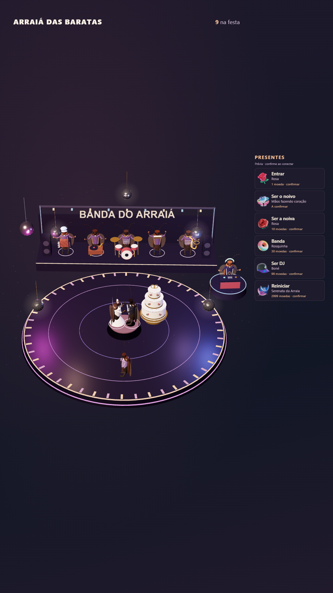

# Arraiá das Baratas · Roda Live 3D 🪳
Uma festa interativa para TikTok: baratas com carapaça segmentada em tons naturais, cabeça estreita, olhos laterais, mandíbulas, dois braços, duas pernas, antenas longas, asas com nervuras e roupas variadas, casal no centro, banda de cinco músicos e DJ. Todos os modelos, instrumentos e movimentos são gerados em Three.js/WebGL2, sem CDN.

## Presentes e papéis
| Ação | Presente configurado | Valor por unidade |
| --- | --- | --- |
| Entrar na roda | Rosa | 1 moeda |
| Ser o noivo | Mãos Fazendo Coração / Finger Heart | 5 moedas |
| Ser a noiva | Rosa de 10 moedas | 10 moedas |
| Integrar a banda | Rosquinha / Doughnut | 30 moedas |
| Ser DJ | Boné / Cap | 99 moedas |
| Acabar e reiniciar a festa | Serenata de arraiá | 2999 moedas |

O valor é o de uma unidade do presente, não a soma do combo. Dez rosas comuns continuam sendo rosas comuns e não concedem a vaga de noiva.

**O catálogo é carregado automaticamente ao conectar.** Para o público, o overlay mostra só o ícone de cada presente e o que ele faz; nome, moedas e status ficam no painel. Uma ação só é confirmada quando há uma correspondência única por nome/ID e custo. Se o presente não existir na live, aparece indisponível. Se houver variantes, selecione o item em **Presentes da live** e salve o mapa. Nunca escolhemos um presente apenas por ter o mesmo preço.

Os valores da tabela são os configurados para esta festa, não uma garantia do catálogo atual do TikTok. O valor é por unidade. O noivo usa `Finger Heart` (Mãos Fazendo Coração); `Hand Heart` (Mãos em Coração) e `Heart Me` são presentes diferentes e não concedem esse papel. O reinício requer o item confirmado e valor de 2999 moedas. Catálogo, itens sazonais e captura real devem ser conferidos na conta que transmitirá.
## Como a festa funciona
- A rosa coloca o doador na roda com seu nome e renova o tempo de permanência.
- Noivo e noiva são disputados separadamente. Quem envia o presente ocupa o papel até outro doador substituí-lo.
- A banda tem **sanfona, vitrola, bateria, gaita e saxofone**. Os cinco músicos ficam em um palco atrás da roda, ainda visível na visão geral.
- As primeiras cinco rosquinhas de doadores diferentes ocupam as cinco posições. Depois, novos doadores substituem as posições em rodízio. Um mesmo doador não ocupa duas posições.
- O boné coloca o doador no posto de DJ, com console e fones.
- Cada pessoa ocupa um único papel. Ao assumir outro, libera o anterior. Um substituído retorna à roda. Não existe limite fixo de entrada; a permanência configurável continua renovada pelas rosas.
- Papéis especiais não expiram pelo tempo normal da roda. Os nomes aparecem acima da cabeça dos participantes visíveis, inclusive na visão geral e durante comentários; comentários exibem o autor e ficam limitados a dois balões sem sobreposição.
- A Serenata de 2999 reinicia participantes, casal, banda, DJ, contadores e áudio. Mantém o mapa de presentes, as configurações, a conexão e os arquivos de música locais. O nome de quem reiniciou aparece no aviso.

A câmera alterna planos gerais e closes aleatórios a cada poucos segundos, inclusive enquanto só há convidados de ambiente. O presente mais recente interrompe o enquadramento anterior imediatamente. Na entrada por rosa, o personagem acena para a câmera e o aviso aparece ao receber o evento. Comentários procuram espaço sem cobrir corpos, nomes ou outras bolhas.

A pista dança individualmente a 144 BPM, com passos mais rápidos e variações por personagem. Noivo e noiva também dançam separados e voltados para a câmera. A distribuição usa uma espiral que cresce com as entradas, mantém posições estáveis e pelo menos 3,2 unidades entre os personagens. Piso, salão, palco e enquadramento acompanham a expansão. Não há teto artificial de participantes; a capacidade prática depende da GPU. O arquivo de música não passa por detecção automática de BPM. Banda e DJ mantêm suas animações nos postos separados.

Presentes em combo são processados desde a primeira unidade: entrar, alertar e focar não aguardam o fim da sequência. Atualizações seguintes contam somente o incremento e não repetem o aviso nem reassumem papéis.

A festa mantém dez convidados de ambiente enquanto houver poucos participantes. Eles dançam avulsos, usam roupas e acessórios diferentes e não têm nomes, presentes, comentários ou papéis de doadores. Conforme chegam participantes reais, esses convidados cedem lugar. O contador inclui apenas participantes reais. O reinício restaura a composição de ambiente.

O catálogo do overlay mostra só ícones e funções, sem preço nem “a confirmar”. A conexão, eventuais itens indisponíveis e a validação dos IDs continuam visíveis no painel. Remover o texto do overlay não transforma o modo local em uma conexão TikTok confirmada.
## Cenário do casamento
Um bolo de três andares, com cobertura, detalhes dourados, flores e alianças no topo, fica ao lado dos noivos. A câmera do noivo inclui o bolo no enquadramento. A pista reserva o centro para os dois personagens e o bolo; convidados dançam na espiral externa.

Cinco globos espelhados com brilho suave giram pelo salão, além do globo já existente. Dois refletores de balada varrem a pista com feixes visíveis, manchas coloridas no chão e transições suaves entre azul, rosa e outras cores, sem efeito estroboscópico. A iluminação de base continua quente. As roupas e acessórios continuam variados, com tecidos mais sóbrios e a aparência da carapaça preservada. Banda e DJ permanecem em seus postos e mantêm as animações dos instrumentos.
## Executar
Instale Node.js 22+:

~~~sh
npm ci
npm start
~~~

Painel: http://localhost:3000
Cena: http://localhost:3000/overlay.html

No Windows, **INICIAR.bat** mantém o servidor no terminal. **ABRIR-LIVE.bat** inicia o servidor se necessário e abre a cena em uma janela dedicada de Edge/Chrome, sem barra de endereço.

## TikTok Live Studio — link local restaurado
1. Execute **INICIAR.bat** e abra o painel em http://localhost:3000.
2. Use **Copiar link vertical**. O painel voltou a usar `http://localhost:3000/overlay.html?source=1&format=portrait`, sem substituir o endereço por um túnel externo.
3. No LIVE Studio, clique com o botão direito na fonte **Link → Configurações**. Ative **Resolução personalizada** e preencha **Largura 1080 / Altura 1920**; aplique. Depois use **Tela cheia → Ajustar à tela**, preservando a proporção. Para horizontal, copie o link horizontal e configure **1920 × 1080**. O tamanho nas propriedades da fonte define a resolução de captura; arrastar ou esticar a caixa na cena não aumenta essa resolução. O endereço do overlay não altera as propriedades do LIVE Studio automaticamente.
4. Ajuste a fonte à tela preservando a proporção. Não amplie uma fonte criada em 800 × 600 para preencher uma transmissão vertical.

A saída usa canvas em tela inteira, cenário cobrindo o quadro, antialiasing e 30 FPS como alvo na fonte Link. O painel conserva a prévia silenciosa. A composição se adapta ao tamanho real da fonte, com o catálogo sobreposto à direita e comentários procurando espaços livres.

O painel não gera nem copia links externos automaticamente. O suporte anterior a túnel HTTPS permanece opcional na API `/api/source-link`, para compatibilidade, mas não substitui o endereço local. O túnel é temporário e não oferece garantia de aceitação pelo LIVE Studio.

Somente a cena e a faixa em reprodução são publicadas pelo gateway. Painel, conexão TikTok, configurações e downloader permanecem locais. O link HTTPS usa consultas de estado mantidas abertas por até oito segundos e respondidas assim que ocorre uma mudança; não há espera de 750 ms entre consultas. Quick Tunnels não suportam SSE. A cena pode enviar apenas os eventos de duração e fim da faixa; comandos de reprodução ficam no painel.

O caminho alternativo `/overlay/festa?source=1` continua compatível. **ABRIR-LIVE.bat** permanece disponível para prévia em janela. A qualidade de codificação e a resolução da transmissão continuam sendo controladas pelo LIVE Studio. Veja [configuração e limites](docs/live-studio.md).
## Música
Instale yt-dlp, FFmpeg e ffprobe no PATH ou coloque os executáveis em tools/. INSTALAR-AUDIO.ps1 auxilia via winget no Windows.

Cole um link de vídeo compatível com yt-dlp e clique em **Baixar e tocar na live**. O servidor extrai MP3 para music/ e inicia automaticamente a faixa na cena. Há pausa, retomada, volume, posição e cancelamento.

Aceita vídeo ou **playlist do YouTube** (até 50 músicas; vídeos indisponíveis são pulados; os "Mix" automáticos `list=RD…` baixam só o vídeo). A primeira música já toca enquanto o resto baixa. Todos os MP3 de `music/` formam a playlist, na ordem em que foram baixados: ao acabar uma, toca a próxima, e depois da última volta à primeira. No painel há ⏮ ⏭ e a lista clicável. Sem streams ao vivo; limite de 1 GB por vídeo. Use conteúdo autorizado.

Só uma fonte toca o som. A fonte Link do LIVE Studio tem prioridade: abrir o overlay em uma aba comum não tira o som da live. Se a festa for reiniciada, o download em andamento é cancelado e não pode reativar o áudio da festa anterior.

## Conexão TikTok
Digite o @ de uma conta ao vivo. O conector é não oficial e depende do TikTok e do provedor de assinatura. Se exigida, defina EULER_API_KEY no ambiente antes de iniciar; arquivos .env não são lidos automaticamente. Nunca publique credenciais.

## Verificação
~~~sh
npm test
node qa-party.mjs
~~~

Os testes cobrem valores unitários, combos imediatos sem contagem duplicada, papéis exclusivos, substituições, mil entradas, espaçamento da espiral, alternância da câmera, resposta do link, migração e reinício. A verificação visual usa Edge no Windows com WebGL2 e testa os instrumentos, dança individual, expansão sem colisões, tempo do alerta/foco, balões e Serenata nos formatos 1080 × 1920 e 1920 × 1080. Ela usa servidor e dados isolados na porta 3011, sem limpar a sessão de transmissão.

As entradas antigas qa.mjs, qa-camera.mjs e qa-wedding.mjs encaminham ao teste atual. Resultados e capturas ficam em verificacao/, ignorados pelo Git. O teste não efetua compras nem envia presentes reais.

A captura dentro do TikTok Live Studio e os IDs efetivos dos presentes exigem conferência no computador e na conta da transmissão.

## Arquivos
| Arquivo | Responsabilidade |
| --- | --- |
| party.js / wheel.js | Regras dos presentes e estado da festa |
| public/party-layout.js | Papéis e distribuição do elenco |
| public/spiral-layout.js | Posições estáveis e expansão da pista sem sobreposição |
| public/roach.js | Baratas humanoides, roupas e movimentos |
| public/instruments.js | Sanfona, vitrola, bateria, gaita, sax e console |
| public/backstage.js | Palco da banda e área do DJ |
| public/scene3d.js | Câmera, luzes, balões e overlay |
| server.js / media.js / music.js | Servidor, downloader e áudio |

O servidor escuta em 127.0.0.1. PORT altera a porta; dados ficam em data/state.json e MP3 em music/. Executáveis, dados locais, credenciais e testes visuais são ignorados pelo Git. A migração instala o novo mapa de seis presentes e mantém as outras preferências.

[Three.js](https://threejs.org/) · [TikTok Live Connector](https://github.com/zerodytrash/TikTok-Live-Connector) · [yt-dlp](https://github.com/yt-dlp/yt-dlp) · [FFmpeg](https://ffmpeg.org/)
## Desenvolvimento com menos contexto
RTK, Ponytail, Headroom e o mapa de módulos estão documentados em [docs/tooling.md](docs/tooling.md).
