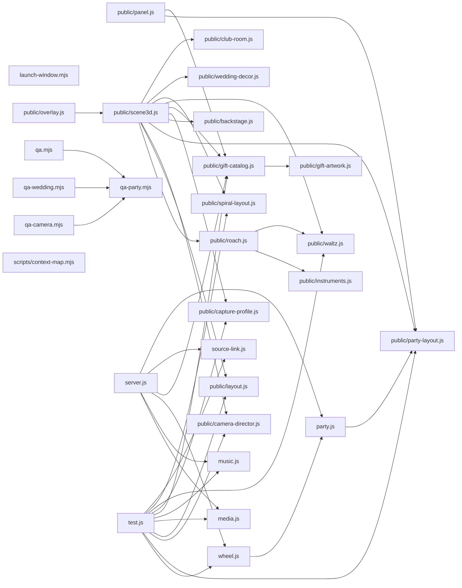

# Mapa de contexto

Índice estático de imports e exports; evita reler o projeto inteiro. Gere novamente após mudar módulos.

Fluxos principais: presentes → server.js → wheel.js → party.js → public/party-layout.js; visual → scene3d.js → roach.js/instruments.js/backstage.js; câmera → camera-director.js.
